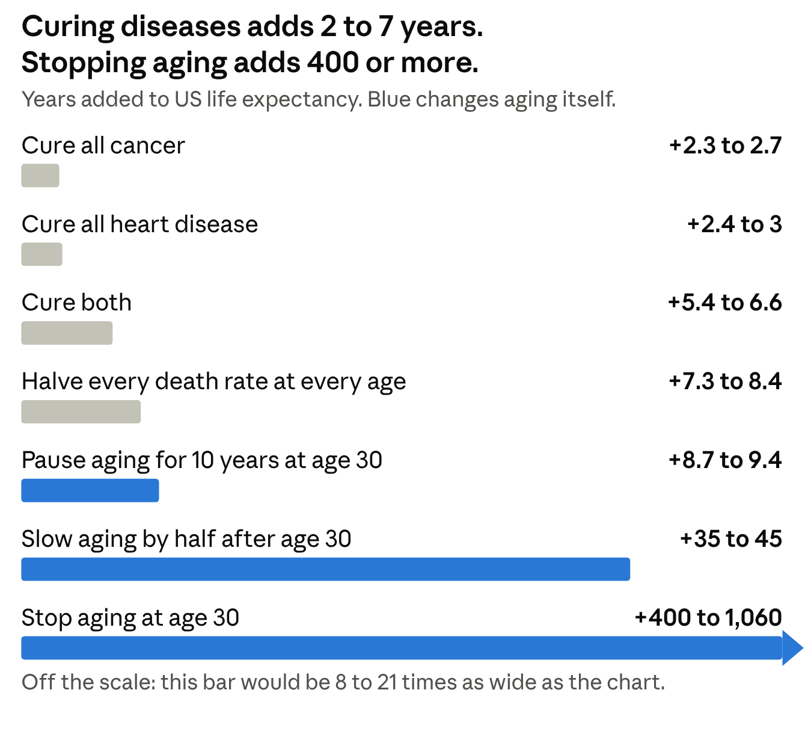
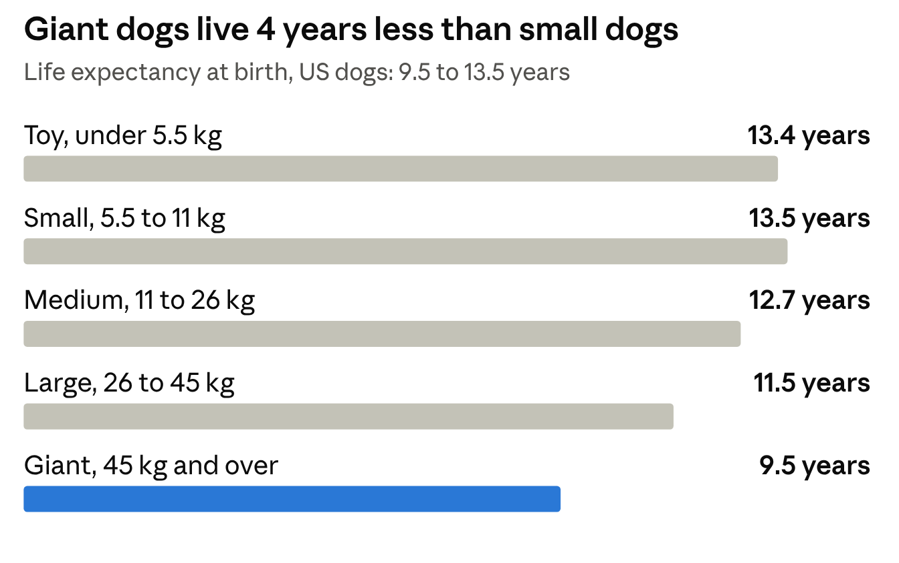
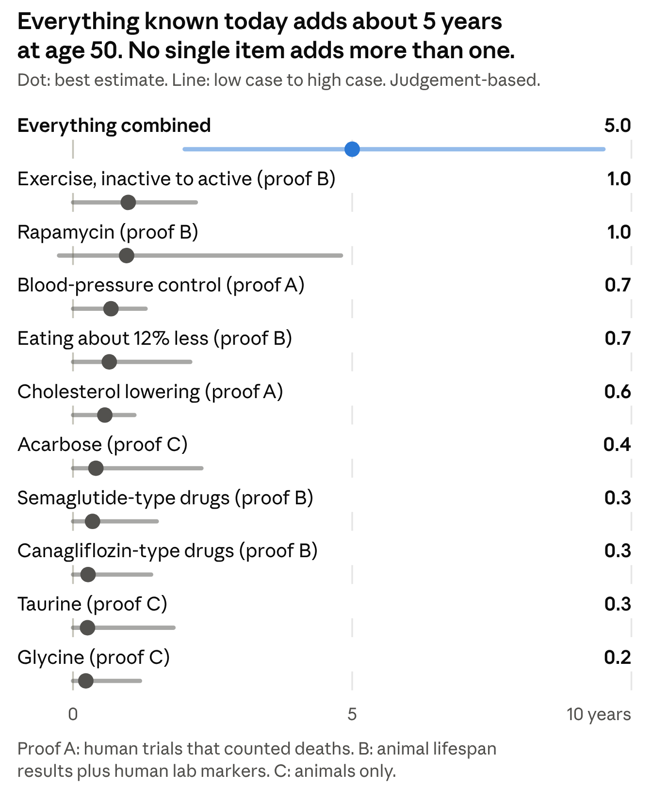

# The Math of Aging: Humans and Dogs

10 November 2026

## The short version

Aging, in numbers, is one fact: your yearly risk of dying doubles on a fixed schedule. In adult humans it doubles about every 8 years. In dogs it doubles about every 2.2 years. Everything else in this report follows from that.

The numbers come from official US death records and two large dog datasets. Each was computed twice, by separate AI agents.

```latex
\text{death rate at age } x = a\,e^{bx}
```

The death rate at age x starts at a low level a and grows by a fixed percentage b every year. The level a is how fragile you are when young. The rate b is how fast you age.

**Five things the math already tells us**

1. **Curing diseases one at a time barely helps.** Wiping out all cancer would add 2.3 to 2.7 years to US life expectancy. The doubling keeps going, so something else gets you soon after.
2. **Halving your death risk buys only one doubling time.** Cut the risk of death in half at every age and a human gains about 8 years, a dog about 2. This is why diet, exercise and medicine add years, not decades.
3. **The prize for stopping the doubling is enormous.** A 30-year-old's risk of death is about 1 in 480 per year for men and 1 in 1,140 for women. If it stayed there, the average life would run about 480 years for men and 1,140 for women. People would still die, from accidents and illness, just not from age.
4. **So "solving aging" has a precise meaning.** It means making b zero: the death rate stops rising with age. Slowing aging means making b smaller. Nothing available today is proven to change b in humans.
5. **Dogs are the fast test.** Dogs age roughly 3.5 times faster than we do and share our homes. A trial that needs 15 years in people can finish in under 5 in dogs. Big dogs age fastest: giant breeds live about 9.5 years, small breeds 13.5.

**Where things stand today.** The best-proven lifespan gains are in animals: the drug rapamycin extends mouse lifespan by 23 to 26 percent, and Labradors fed 25 percent less lived about 1.8 years longer. No drug has yet been shown to extend human lifespan by slowing aging itself.

Everything known today, combined, might add about 5 years to a 50-year-old and about 1 year to a 7-year-old dog. Outrunning aging would take death rates falling 8 percent a year, and the US has managed under 1 percent. So aging is not solved. The sections below show the working and what would have to change.

## How humans age, in numbers

An American adult's risk of dying doubles about every 8 years: between 7 and 9 depending on how it is measured. That single pattern matches the official 2023 US death rates from age 40 to 80 within about 1 percent ([Social Security life table](https://www.ssa.gov/oact/STATS/table4c6.html)).

```latex
\mu(x) = c + a\,e^{bx}
```

The yearly risk of death at age x is a constant background risk c (accidents, violence, infections) plus an aging term that grows by a fixed percentage b every year.

| US, 2023 | Men | Women |
| --- | --- | --- |
| Life expectancy at birth | 75.8 years | 81.1 years |
| Risk of death at age 30 | 1 in 480 per year | 1 in 1,140 per year |
| Time for risk to double | 7.1 to 8.7 years | 6.8 to 7.9 years |
| Most common age at death | 87 | 89 |

**What moves life expectancy, and what does not.** Because risk keeps doubling, removing one cause of death just hands you to the next one a few years later.



*Computed from the US Social Security 2023 life table · each range spans men and women*

**Is there a maximum lifespan?** Unsettled. The record is 122 years (Jeanne Calment, died 1997). In verified records of 3,836 Italians aged 105 and over, the risk of death stopped rising and sat near 50 percent a year ([Barbi 2018](https://pmc.ncbi.nlm.nih.gov/articles/PMC6457902)); critics argue tiny age-recording errors could fake that. It matters: if risk keeps doubling, the oldest of a billion women reaches about 118. If it levels off, about 128, with no hard ceiling.

**Why does risk double at all?** Three different explanations produce the same curve, and death records alone cannot tell them apart:

- The body runs out of spare parts. It starts with built-in redundancy, and risk rises as backups fail.
- Reserve declines steadily, so ever-smaller shocks become fatal.
- The frail die first, which makes the curve bend at the oldest ages.

**Where the formula fails.** It does not describe infants, children, or the bump in deaths among young adults from accidents and overdoses. Above age 95 the official rates are themselves estimates.

## How dogs age, in numbers

A dog's risk of dying doubles about every 2.2 years, against about 8 for a person. Dogs age roughly 3.5 times faster than we do, not 7 times. Two independent datasets agree: a UK table built from 30,563 dog deaths ([Teng 2022](https://pmc.ncbi.nlm.nih.gov/articles/PMC9050668)) and a US table from Banfield vet hospitals ([Montoya 2023](https://www.frontiersin.org/journals/veterinary-science/articles/10.3389/fvets.2023.1082102/pdf)).

|  | Dogs | Humans (US) |
| --- | --- | --- |
| Life expectancy at birth | 11.2 years (UK), 12.7 (US) | 75.8 men, 81.1 women |
| Risk of death doubles every | 2.0 to 2.3 years | 7 to 9 years |
| Yearly risk as a young adult | about 1 in 110 to 170 (age 2) | about 1 in 480 to 1,140 (age 30) |

Dogs live 6 to 7 times shorter lives but age only about 3.5 times faster. The rest of the gap is that a young adult dog already carries several times the death risk of a young adult human.

**Big dogs die young.** Each doubling of body weight costs a dog about 7 percent of its life expectancy. Giant breeds live 4 years less than small ones.



*Montoya 2023 · US Banfield vet hospital records, 2013 to 2019*

The best evidence says big dogs age faster; they do not start aging sooner ([Kraus 2013](https://jhanley.biostat.mcgill.ca/bios601/Applications/LongevityOfDogs.pdf), 74 breeds, 56,637 dogs). Across species the rule runs the other way: elephants outlive mice. Both hold because they have different causes. Big species evolved slow aging over millions of years. Big dog breeds were made in a few centuries by pushing growth, largely through one growth gene (IGF-1), with no matching slowdown in aging. That explanation rests on correlations, not experiments.

**Dog years.** After the first two years, each dog year is worth about 4 human years. Our match pairs ages at which the same share of dogs and people are still alive.

| Dog age | "Times 7" rule | DNA formula | Our survival match |
| --- | --- | --- | --- |
| 1 | 7 | 31 | 33 |
| 2 | 14 | 42 | 39 |
| 4 | 28 | 53 | 46 |
| 7 | 49 | 62 | 57 |
| 10 | 70 | 68 | 69 |
| 12 | 84 | 71 | 78 |
| 14 | 98 | 73 | 85 |
| 16 | 112 | 75 | 91 |

```latex
\text{human age} = 16\,\ln(\text{dog age}) + 31
```

That is the DNA formula, built from chemical marks on the DNA of 104 dogs, mostly Labradors (Wang 2020). It agrees with survival up to about age 10, then undercounts old dogs. "Times 7" overcounts them.

**What dogs die of.** Under age 3 it is mostly behaviour problems, gut disease and road accidents; cancer is 2 percent of deaths. From age 3, cancer leads at 18 percent, then joint and nerve disease at about 12 percent each ([O'Neill 2013](https://rvc-repository.worktribe.com/OutputFile/1409027)).

**Why dogs matter for human aging.** Proving that a drug cuts death risk by 20 percent takes about 630 deaths in the trial, in any species. Dogs supply them faster.

- With 2,000 participants: under 5 years in large dogs aged 7, about 15 years in people aged 65.
- In a 3-year trial: about 4,000 large dogs, or about 16,700 people aged 65.
- Even dog trials are tight. A 580-dog, 3-year trial would catch a 20 percent effect less than one time in five, if death were its only measure. The designers of the 580-dog rapamycin trial report much higher power from their own simulations; the two estimates have not been reconciled.

## What is actually breaking

No single part fails. Every model of aging we built gives the same rule: risk keeps rising only while something in the body's damage process gets worse with age, or cannot be repaired. Remove both conditions and risk goes flat. That rule is proven mathematics for these models. How far a real body is from it is unknown.

**Why aging exists at all.** Natural selection stops caring once reproduction ends. A gene that harms you at 70 costs almost no offspring, so such genes pile up. And a body that spent everything on repair would have nothing left for reproduction, so evolution never buys perfect repair. Aging is the evolved default, not a malfunction.

**The best-tested mechanism: worn-out cells.** Damaged "senescent" cells stop dividing and inflame the tissue around them ([Karin 2019](https://pmc.ncbi.nlm.nih.gov/articles/PMC6889273)).

```latex
\frac{dX}{dt} = \eta\,t \;-\; \frac{\beta X}{\kappa + X} \;+\; \text{noise}
```

The load of worn-out cells X is produced faster every year (first term). The body clears them, but clearing saturates when there are many (second term). Random swings eventually push the load past a lethal level.

With the published human settings, this one equation reproduces a life expectancy of 77.7 years, risk doubling every 6 to 7 years, and the slowdown seen after age 80. In the model:

- Boosting clearance by 50 percent adds about 49 years.
- Freezing production at its age-60 level makes risk flat for good, near 1 percent a year.
- Dogs are not just fast humans. Speeding up production alone cannot reproduce the dog curve; dogs would also need weaker clearance or more random swings.

These are properties of the model, far larger than any drug has shown. Death records alone cannot pin down its settings.

**Other clocks and counters**

| Mechanism | What the math shows |
| --- | --- |
| Telomeres (chromosome caps) | A cell stops dividing when the shortest of its 92 caps runs out, which halves the count you would expect from the average cap. Average loss in blood looks too slow to limit lifespan by itself. |
| DNA mutations | Mammals end life with about 3,200 mutations per gut stem cell, whatever their lifespan. Humans add 47 a year; dogs are predicted to add 200 to 270 ([Cagan 2022](https://pmc.ncbi.nlm.nih.gov/articles/PMC9021023)). |
| Epigenetic clocks | A clock built on 353 DNA marks tells age to within 3.6 years. Our simulation built a working clock from pure random drift, so a clock that moves does not prove aging slowed. |
| Cancer | Needing several rare hits makes cancer rise with about the 6th power of age. In dogs, risk goes as body weight times lifespan to the 4th power, peaking in 33 kg breeds. |
| Resilience | Recovery from everyday stress slows from about 2 weeks at age 40 to 8 weeks at 90, pointing to zero at 120 to 150 years. The estimate is fragile: our test of the method missed by 40 years. |

**What kind of fix changes what.** Slowing damage production stretches the whole curve, so risk doubles more slowly. Boosting repair mostly shifts the curve later without changing the doubling. Periodically removing damage is very powerful if damage is reversible and nearly useless if it is not. Which of those describes most human aging damage is an open question.

## What could slow it

Everything known today, combined, would add about 5 years to a 50-year-old (range 2 to 10) and about 1 year to a 7-year-old dog. That closes roughly 2 percent of the gap to stopped aging. These totals are structured estimates built on judgement, not measurements. This section describes evidence; it is not advice on what you or your dog should take.

**The conversion.** Trials report how much a treatment cuts the risk of death (the hazard ratio, HR). Because risk doubles on a schedule, a cut in risk is the same as being younger by a fixed number of years:

```latex
\text{years younger} \approx \frac{-\ln(\mathrm{HR})}{b}
```

Here b is the yearly growth rate of risk. A 20 percent cut in death risk is worth about 2.3 years to a 50-year-old human and about 0.5 years to a 7-year-old dog. The shortcut overstates the gain when treatment starts late in life.

**Mice.** The US government's testing program, which runs each drug at three labs, found these changes in typical lifespan ([NIA program](https://www.nia.nih.gov/research/dab/interventions-testing-program-itp/supported-interventions)):

| Treatment | Males | Females |
| --- | --- | --- |
| Rapamycin | +23% | +26% |
| Rapamycin plus acarbose | +34% | +28% |
| Acarbose | +22% | +5% |
| 17-alpha-estradiol | +19% | none |
| Canagliflozin | +14% | 6% shorter |
| Metformin, resveratrol, nicotinamide riboside, fisetin | none | none |

**Humans.** The only randomised proof of fewer deaths comes from treating disease risk, not aging itself:

- Intensive blood-pressure control: 27 percent fewer deaths (SPRINT trial).
- Statins: 10 percent fewer per unit of cholesterol lowered.
- Empagliflozin in diabetics with heart disease: 32 percent fewer.
- Semaglutide in obese people with heart disease: 19 percent fewer.

No drug aimed at aging has outcome results in healthy people. The metformin trial (TAME) had still not enrolled anyone, according to reports in September 2026. A rapamycin trial (PEARL) missed its main goal. Eating 12 percent less for two years slowed one aging clock by 2 to 3 percent and left two others unchanged (CALERIE).

**Dogs.**

- Labradors fed 25 percent less from puppyhood lived a typical 13.0 years against 11.2. This is the only randomised lifetime result in dogs: 48 dogs, one company-run study.
- Loyal's LOY-002, a daily pill for dogs aged 10 and over, has had its effectiveness and safety sections accepted by the FDA. We found no conditional approval as of 10 November 2026. Its 1,300-dog trial has no results yet.
- Loyal's two drugs for large dogs have had effectiveness sections accepted (2023 and September 2026). Acceptance means a "reasonable expectation" of benefit, not proof of longer life.
- The Dog Aging Project's rapamycin trial plans 580 dogs, with results expected around 2029.

**Reprogramming.** Resetting cells toward a younger state reached its first human in June 2026, in a safety trial for eye disease. Whole-body versions have caused organ failure and tumours in mice.

**Ranked estimate for a 50-year-old human**



*Our simulation, 200,000 runs · inputs are judgement calls anchored on the trials above · line spans the 5th to 95th percentile*

Each bar multiplies three judgement calls: the chance the effect is real, how much of a mouse result carries over, and how much treatments overlap. Halving our confidence in every treatment gives a total of 2.7 years. Assuming every candidate works gives about 16. Even that best case is small next to stopped aging, which would take a 99 percent cut in aging-related death risk.

**Harms.** Our estimate barely models them. Known ones include immune suppression and raised blood sugar with rapamycin, infections with canagliflozin-type drugs, and gut side effects with semaglutide.

## Escape velocity

To outrun aging, death rates at every age would have to fall about 8 percent a year, every year. The US has managed 0.5 to 1 percent. Progress is 8 to 17 times too slow. "Escape velocity" is the point where medicine improves fast enough that your remaining years stop shrinking as you age.

```latex
\rho \ge b
```

If aging-related death rates fall by a fraction ρ each year, everyone in effect gets ρ/b years younger each year. You stop aging in risk terms when ρ reaches b, the yearly growth of risk. That is about 8 percent a year for humans and about 27 percent for dogs. The result is exact within the model and the same at every age.

**It is a knife edge.** Years a 50-year-old can expect to have left, by pace of progress:

| Pace, as a share of the needed 8% a year | Years left at 50 |
| --- | --- |
| None | 33 |
| Half | 52 |
| 90% | 123 |
| 100% | 272 |
| 110% | about 1,300 |

**History against the requirement.**

- The best national life expectancy rose about 2.4 years per decade for 160 years. That is a quarter of one year per year.
- US life expectancy at 65 went from 13.9 years (1950) to 19.1 (2010) to 19.7 (2024). The pace halved after 2010.
- Japanese women at 65 have not gained since 2017 (24.43 to 24.38 years).
- A 2024 study of the longest-lived countries concludes that survival to 100 is unlikely to pass 15 percent of women and 5 percent of men this century unless aging itself is slowed (Olshansky 2024).

**The repair route.** Instead of slowing damage, remove it on a schedule. Suppose a treatment every T years clears a fraction f of the damage:

- Damage that builds at a steady pace levels off for any f above zero. Clearing half every 10 years holds a body between 10 and 20 years' worth of damage, for good.
- Damage that feeds on itself must be cleared faster than it regrows:

```latex
f > 1 - e^{-gT}
```

Here g is how fast the damage grows by itself. Each treatment must remove at least what grew back since the last one.

**The weakest link decides.** In a model with seven kinds of damage, fully repairing six every year and never touching the seventh gives an expected age at death near 380, against about 1,800 with all seven repaired. The split into seven equal kinds is illustrative.

**If it worked.**

- People would still die. At today's accident rate alone the average life would run about 1,900 years. At the full death rate of a 30-year-old it is 480 years for men and 1,140 for women.
- Population growth is set by births, not deaths. At 1.5 children per woman a population still shrinks about 1 percent a year in the long run, with or without aging. It would be far larger for centuries on the way.
- One extra year of healthy life expectancy is valued at about 38 trillion dollars for the US alone (Scott 2021).
- Dogs need about three times the pace. Progress that froze human aging would add under 2 years to a 6-year-old dog.

## Roadmap: what is still unsolved

Aging is not solved, and the math says exactly why: nothing yet changes how fast the risk of death doubles. Six open questions decide whether that can change. The order is our judgement, not a measurement.

| Rank | Open question | Why it matters | What would settle it |
| --- | --- | --- | --- |
| 1 | Is any kind of damage beyond repair? | It sets the ceiling. One unrepairable kind out of seven caps life near 380 years in our model. | Mouse studies that remove one kind of damage at a time and measure how much the rise in death risk flattens. |
| 2 | Does aging have a few root causes or many separate ones? | A few causes means one treatment can do a lot. Many means each fix buys a little. | Combination trials in mice. Rapamycin plus acarbose gave 34 percent against 23 and 22 alone, so effects add only partly. |
| 3 | Can a blood or DNA test stand in for lifespan in trials? | Without one, a human trial needs tens of thousands of people and decades. No aging test has passed validation. | Measure the tests inside trials that also count deaths. Dog trials are the fastest place: 1,300 dogs in Loyal's, 580 planned in the rapamycin trial. |
| 4 | Do mouse results carry over to dogs and people? | It is the most influential number nobody has measured. | The same drug tested in mice, dogs and humans. Rapamycin in dogs is the first such test. |
| 5 | Will regulators accept aging as something to treat? | With no approval route, companies cannot fund the trials. | A first approved lifespan claim for a dog drug, and a funded human trial that counts several age-related diseases together. |
| 6 | Is cell reprogramming safe across the whole body? | It is the main candidate for reversing damage, and it has killed mice. | Long whole-body studies in large animals, limited to chosen tissues. |

**Where dogs fit.** Three of the six questions get their first real answers from dog trials already running, because a dog trial reads out in 3 to 5 years where a human one takes 15 to 30.

**The honest scorecard.**

- Solved: the description. We can predict death risk by age in both species, and say exactly what each change to it is worth.
- Partly solved: the mechanisms. Several models reproduce the curve, and each says what would flatten it.
- Not solved: any treatment that slows the doubling in humans or dogs. The first tests that could show one are the dog trials due between now and about 2029.

## How this was checked, the code, and sources

Every headline number here was computed twice by separate AI agents, and the two agreed on almost all of them. Five agents each built one part: data, equations and code. Five different agents then re-ran that code, rebuilt the key numbers with their own code, and re-opened the sources.

**What the check changed**

- Dogs age 3.3 to 3.7 times faster than humans, not 3.75. The higher figure mixed two fitting methods.
- Slowing aging by 10 percent adds 3 to 5 years; the answer depends on how "slowing" is defined.
- The statin figure now uses the newer 2010 estimate: 10 percent fewer deaths, not 12.
- The treatment estimates now use the measured aging rates in place of provisional ones. The combined estimate moved from 4.8 to 5.0 years for humans and from 1.3 to 1.2 for dogs.

**What could not be fully verified**

- The measured mutation rate in dogs. We use a prediction. Also the exact share of children expected to reach 100: two readings of the source paper disagreed, so the report quotes only the paper's stated ceiling.
- The exact status of the metformin trial and of Loyal's approval. Both rest partly on news reports, not the sponsors' own pages.
- US death rates above age 95, which are official estimates, so the late-life levelling-off is uncertain.
- Cause-of-death shares by age, which come from New York State, not the whole US.
- The size-class results for dogs, which are calibrated to published life expectancies, not fitted to full tables.

**What is judgement, not data.** The ranked treatment estimates, the roadmap order, and every model setting marked illustrative. They are stated assumptions run through arithmetic.

**The code.** About 30 Python scripts, with the transcribed data tables and 35 figures, are in this repository. Each part re-runs in under two minutes and reproduces its numbers exactly.

**Main sources**

- [US Social Security period life table, 2023](https://www.ssa.gov/oact/STATS/table4c6.html)
- [CDC: Mortality in the United States, 2024](https://cdc.gov/nchs/products/databriefs/db548.htm)
- [Barbi 2018, death rates after age 105](https://pmc.ncbi.nlm.nih.gov/articles/PMC6457902)
- [Oeppen and Vaupel 2002, record life expectancy](https://u.demog.berkeley.edu/~jrw/Biblio/Eprints/%20M-O/oeppen.vaupel.2002.pdf)
- [Japan Ministry of Health life tables, 2024](https://www.mhlw.go.jp/english/database/db-hw/lifetb24/dl/lifetb24-01.pdf)
- [Teng 2022, UK dog life tables](https://pmc.ncbi.nlm.nih.gov/articles/PMC9050668)
- [Montoya 2023, US dog life tables](https://www.frontiersin.org/journals/veterinary-science/articles/10.3389/fvets.2023.1082102/pdf)
- [McMillan 2024, lifespan of 584,734 UK dogs](https://www.nature.com/articles/s41598-023-50458-w.pdf)
- [Kraus 2013, why large dogs die young](https://jhanley.biostat.mcgill.ca/bios601/Applications/LongevityOfDogs.pdf)
- [O'Neill 2013, causes of death in dogs](https://rvc-repository.worktribe.com/OutputFile/1409027)
- [Wang 2020, dog-to-human age from DNA marks](https://www.biorxiv.org/content/10.1101/829192.full.pdf)
- [Karin 2019, worn-out cells and the mortality curve](https://pmc.ncbi.nlm.nih.gov/articles/PMC6889273)
- [Cagan 2022, mutation rates and lifespan](https://pmc.ncbi.nlm.nih.gov/articles/PMC9021023)
- [Pyrkov 2021, loss of resilience](https://link.springer.com/content/pdf/10.1038/s41467-021-23014-1.pdf)
- [Horvath 2013, the epigenetic clock](https://link.springer.com/content/pdf/10.1186/gb-2013-14-10-r115.pdf)
- [Meyer and Schumacher 2024, clocks from random drift](https://www.nature.com/articles/s43587-024-00619-x.pdf)
- [Nunney 2024, cancer and body size in dogs](https://escholarship.org/content/qt8w0923ff/qt8w0923ff.pdf?t=s8hg2k)
- [NIA Interventions Testing Program](https://www.nia.nih.gov/research/dab/interventions-testing-program-itp/supported-interventions)
- [Miller 2014, rapamycin in mice](https://pubmed.ncbi.nlm.nih.gov/24341993/)
- [Waziry 2023, CALERIE and aging clocks](https://bpb-us-e1.wpmucdn.com/sites.psu.edu/dist/0/9948/files/2023/02/Waziry-Ryan-et-al.-2023-Nature-Aging.pdf)
- [PEARL rapamycin trial](https://static-site-aging-prod.impactaging.com/article/206235/text)
- [Purina Labrador lifespan study](https://newscenter.purina.com/LifeSpanStudy)
- [Loyal, LOY-002 safety acceptance](https://loyal.com/posts/loy-002-tas-announcement)
- [Texas A&M, Dog Aging Project rapamycin trial](https://vetmed.tamu.edu/news/press-releases/dog-aging-project-triad/)
- [Life Biosciences, first reprogramming trial dose](https://www.biospace.com/press-releases/life-biosciences-announces-first-patient-dosed-in-phase-1-trial-of-er-100-for-optic-neuropathies)
- [Scott, Ellison and Sinclair 2021, value of slowing aging](https://www.london.edu/faculty-and-research/academic-research/a/alls-well-that-ages-well-the-economic-value-of-targeting-aging)
